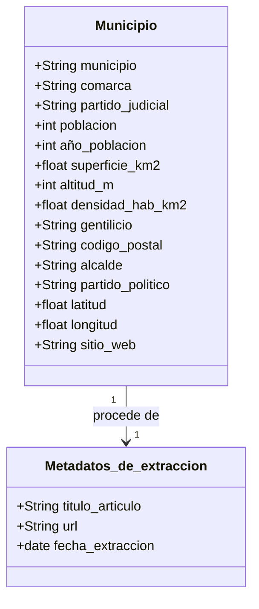
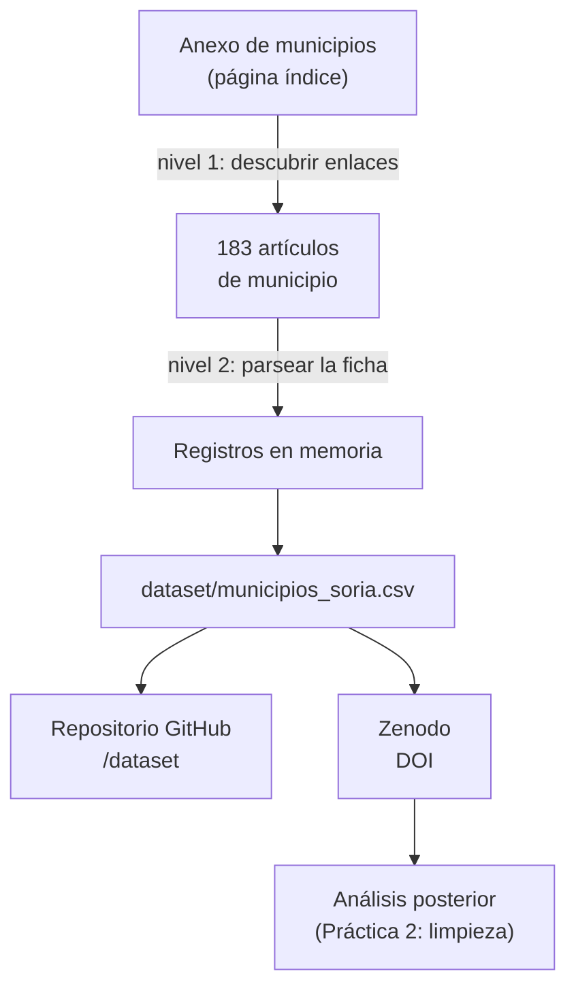

# Práctica 1 — ¿Cómo podemos capturar los datos de la web?

**M2.851 Tipología y ciclo de vida de los datos** · Máster Universitario en Ciencia de Datos (UOC)

---

## Metadatos de la entrega

| Campo | Valor |
|---|---|
| Integrante | Aaron Yeret Mera Arana |
| Sitio web elegido | https://es.wikipedia.org/wiki/Anexo:Municipios_de_la_provincia_de_Soria |
| Repositorio del código | https://github.com/merayeret-eng/Municipios-Soria-Web-Scraping (privado, con acceso al profesor) |
| Dataset publicado | https://doi.org/10.5281/zenodo.24164218 |
| Vídeo de presentación | `<PENDIENTE: https://drive.google.com/...>` |

---

## 1. Contexto

Este proyecto responde a una pregunta sobre el territorio: **¿cómo se reparte la población en una provincia del interior y qué relación tiene con la geografía?** Soria es un caso extremo de despoblación rural: una de las provincias menos densas de España, con la capital concentrando casi la mitad de sus habitantes.

La respuesta necesita una tabla con la población, la superficie y la altitud de **cada municipio** de la provincia, para que cada fila sea una unidad administrativa comparable.

**Sitio elegido:** la Wikipedia en español, anexo
`https://es.wikipedia.org/wiki/Anexo:Municipios_de_la_provincia_de_Soria`.

**Por qué este sitio.** El anexo contiene la lista completa de municipios y **enlaza cada uno con su artículo**, y cada artículo publica una ficha con los datos necesarios. La información es pública, está en español y no requiere autenticación. El sitio no ofrece API para estos datos, así que la vía es el scraping (Subirats y Calvo, 2019).

**Por qué es fiable.** Cada ficha enlaza la fuente de sus cifras —principalmente el INE—, el historial de edición es público y la licencia está declarada en el pie de página.

**Evaluación previa del sitio** (los cinco pasos que propone el material de la asignatura):

| Aspecto | Resultado |
|---|---|
| `robots.txt` | Permite el rastreo de `/wiki/`. Bloquea `/w/`, `/api/`, `/trap/` y las páginas `Special:`, que este proyecto no necesita. |
| Mapa del sitio | El anexo actúa como índice y sustituye al `sitemap`; no es necesario rastrear el sitio a ciegas. |
| Tamaño | Acotado por diseño: 1 página índice + 183 artículos de municipio. |
| Tecnología | HTML estático renderizado en servidor. Sin JavaScript obligatorio, sin `infinite scroll` y sin `CAPTCHA`. |
| Propietario | Fundación Wikimedia. |

---

## 2. Título

**«Municipios de la provincia de Soria: población, superficie y altitud (Wikipedia, 2025)»**

El título fija tema, alcance geográfico, contenido y año del dato.

---

## 3. Descripción del dataset

El dataset contiene **una fila por municipio** de la provincia de Soria: **183 registros y 18 columnas**. Cada fila reúne los datos administrativos, geográficos y demográficos que la ficha del municipio publica en la Wikipedia en español: comarca, partido judicial, población y su año de referencia, superficie, altitud, densidad, gentilicio, código postal, alcalde y partido político, coordenadas y sitio web, junto con la URL de origen y la fecha de extracción.

Los datos se obtuvieron el **12 de noviembre de 2026** mediante un scraper propio en Python que navega desde el anexo provincial hasta el artículo de cada municipio. La población corresponde al año **2025**. El conjunto es un **corte transversal completo** de la provincia en una única fecha de referencia.

El dataset se publica sin limpiar: conserva los valores de la fuente, con sus ausencias y sus inconsistencias. Esa limpieza es el objeto de la Práctica 2.

---

## 4. Representación gráfica

### 4.1 Esquema del dataset (modelo de datos)



Los 18 campos se agrupan en cinco bloques: **identificación** (`municipio`, `titulo_articulo`), **geografía** (`superficie_km2`, `altitud_m`, `latitud`, `longitud`), **demografía** (`poblacion`, `año_poblacion`, `densidad_hab_km2`), **administración** (`comarca`, `partido_judicial`, `codigo_postal`, `alcalde`, `partido_politico`, `gentilicio`, `sitio_web`) y **trazabilidad** (`url`, `fecha_extraccion`).

### 4.2 Esquema del proyecto



---

## 5. Contenido

### 5.1 Campos

| Campo | Tipo | Unidad | Descripción | Ejemplo |
|---|---|---|---|---|
| `municipio` | texto | — | Nombre del municipio tal como aparece en el índice | `Abejar` |
| `comarca` | texto | — | Comarca declarada en la ficha | `Pinares` |
| `partido_judicial` | texto | — | Partido judicial al que pertenece | `Soria` |
| `poblacion` | entero | habitantes | Población del año de referencia | `287` |
| `año_poblacion` | entero | año | Año al que corresponde la población | `2025` |
| `superficie_km2` | decimal | km² | Superficie municipal | `23.43` |
| `altitud_m` | entero | m s. n. m. | Altitud de la capital municipal | `1140` |
| `densidad_hab_km2` | decimal | hab/km² | Densidad declarada en la ficha | `12.25` |
| `gentilicio` | texto | — | Gentilicio(s) del municipio | `aderatense` |
| `codigo_postal` | texto | — | Código postal (se trata como texto para no perder ceros) | `42146` |
| `alcalde` | texto | — | Nombre y apellidos de quien ocupa la alcaldía | `Carolina Romero Plazas` |
| `partido_politico` | texto | — | Siglas del partido declaradas en la ficha | `PSOE` |
| `latitud` | decimal | grados decimales | Latitud (WGS84) | `41.8075` |
| `longitud` | decimal | grados decimales | Longitud (WGS84) | `-2.7855555555556` |
| `sitio_web` | texto | — | Dominio municipal indicado en la ficha | `abejar.es` |
| `titulo_articulo` | texto | — | Título real de la página (revela redirecciones) | `Abejar` |
| `url` | texto | — | URL exacta de la que se extrajo el registro | `https://es.wikipedia.org/wiki/Abejar` |
| `fecha_extraccion` | fecha | ISO 8601 | Día en que se ejecutó el scraper | `2026-11-12` |

Siete campos son numéricos (`poblacion`, `año_poblacion`, `superficie_km2`, `altitud_m`, `densidad_hab_km2`, `latitud`, `longitud`), diez son texto y uno es fecha. El dataset admite análisis estadístico y agrupaciones.

### 5.2 Cobertura temporal

- **Periodo del dato:** población con referencia **2025** (183 de 183 registros). El resto de campos no lleva fecha propia en la fuente; se asume vigente a la fecha de extracción.
- **Fecha de extracción:** **12 de noviembre de 2026**. Un único corte transversal: el dataset no permite analizar evolución temporal.

### 5.3 Completitud observada

La extracción terminó sin errores (183 de 183 municipios). Cobertura de cada campo sobre el CSV final:

| Campo | Cobertura | Campo | Cobertura |
|---|---|---|---|
| `municipio`, `comarca`, `poblacion`, `año_poblacion`, `altitud_m`, `codigo_postal`, `alcalde`, `latitud`, `longitud`, `url`, `fecha_extraccion` | 183/183 (100 %) | `partido_judicial` | 181/183 (98,9 %) |
| `superficie_km2`, `densidad_hab_km2`, `partido_politico` | 180/183 (98,4 %) | `sitio_web` | 158/183 (86,3 %) |
| `gentilicio` | 99/183 (54,1 %) | | |

Las ausencias no se imputan: se exportan como celda vacía. Es material de la Práctica 2.

Con las seis dimensiones de DAMA UK: la **unicidad** se cumple (183 URL distintas, ningún municipio duplicado); la **completitud** es la de la tabla; la **puntualidad** queda limitada por un único corte. **Validez**, **exactitud** y **consistencia** no se evalúan: exigen normalizar y contrastar con la fuente primaria, que es el trabajo de la Práctica 2. El dataset se entrega con su calidad **documentada pero sin corregir**.

---

## 6. Propietario

### 6.1 Titular del conjunto de datos

El sitio es propiedad de la **Fundación Wikimedia** (*Wikimedia Foundation, Inc.*), entidad sin ánimo de lucro con sede en San Francisco que opera la infraestructura de Wikipedia. Los contenidos se publican bajo **CC BY-SA 4.0**, según declara el pie de cada página. La Fundación publica sus condiciones de uso y mantiene un `robots.txt` público que este proyecto consulta y respeta.

### 6.2 Análisis anteriores y trabajos similares

Cuatro referencias:

1. **Instituto Nacional de Estadística (INE).** *Cifras oficiales de población de los municipios españoles: revisión del Padrón municipal.* Fuente primaria de las cifras que la Wikipedia reproduce, y punto de contraste para validar la población.
2. **Cavallo, A. y Rigobon, R. (2016).** «The Billion Prices Project», *Journal of Economic Perspectives*, 30(2). Precedente del scraping a gran escala con fines de investigación: los datos recolectados de la web sostienen investigación académica.
3. **Vanden Broucke, S. y Baesens, B. (2018).** *Practical Web Scraping for Data Science*. Springer. Buenas prácticas y marco legal que se aplican en este apartado.
4. **DAMA UK Working Group.** *The six primary dimensions for data quality assessment.* Marco con el que se evalúa la calidad del dataset (§5.3).

No se ha encontrado un dataset derivado de este anexo con esta granularidad municipal. El proyecto se apoya en los trabajos anteriores por método, no por repetir un resultado existente.

### 6.3 Pasos seguidos para actuar conforme a los principios éticos y legales

El material de la asignatura resume la doctrina en cinco principios. Pasos aplicados:

| Principio | Aplicación en este proyecto |
|---|---|
| **Verificar las condiciones de uso** | Se consultó el `robots.txt` de `es.wikipedia.org` **antes** de la primera petición, y el scraper aborta si la URL no está permitida. Se comprobó que el contenido es CC BY-SA 4.0 y que la reutilización exige atribución y compartir igual. |
| **Rastrear solo información pública** | Solo se accedió a páginas de artículos (`/wiki/`), sin inicio de sesión, sin formularios y sin acceder a páginas especiales o restringidas. |
| **No causar daño** | Una única petición cada **1,2 s** como mínimo, más un retardo aleatorio; 185 peticiones en total; reintentos con espera exponencial ante errores 429/5xx. En ningún momento se paralelizó el rastreo ni se eludió medida de protección alguna. |
| **Identificarse** | User-Agent propio y descriptivo (`UOC-Practica1/1.0` con URL de contacto), registrado en el log de ejecución. No se suplantó a un navegador real ni se rotaron direcciones IP. |
| **Uso justo de la información** | Uso académico y no comercial; atribución de la fuente en el propio dataset (campo `url`) y en el README; publicación del derivado bajo la misma licencia. |

**Protección de datos.** El dataset incluye el nombre de quien ocupa la alcaldía. Es un cargo público y el dato ya está publicado, pero es un dato personal: se mantiene por interés público y finalidad académica, limitado a nombre y partido, sin datos de contacto, y no se cruzará con otras fuentes para elaborar perfiles. No se recoge ningún otro dato personal.

---

## 7. Inspiración

### 7.1 Por qué este dataset es interesante

Porque describe, municipio a municipio, el caso más extremo de despoblación de una provincia española, con cifras comprobables. Indicadores que ya salen del CSV:

- Los 183 municipios suman **90.261 habitantes** en **10.068 km²**.
- La capital, Soria, concentra el **45,5 %** de la población provincial.
- **115 de los 183 municipios** tienen menos de 100 habitantes.
- **150 municipios** tienen una densidad inferior a 5 hab/km², y la **mediana provincial es de 1,76 hab/km²**.
- El municipio menos denso es **Valdeprado** (0,25 hab/km²); el menos poblado, **Villanueva de Gormaz** (6 habitantes).
- La altitud media es de **1.042 m s. n. m.**, con un rango de 735 a 1.391 m.

El dataset dice algo sin necesidad de análisis. Con análisis, es explotable.

### 7.2 Preguntas que se pretenden responder

1. ¿Existe relación entre la **altitud** y la **densidad de población** en la provincia?
2. ¿Qué proporción del territorio ocupan los municipios de menos de 100 habitantes y qué peso demográfico tienen?
3. ¿La **superficie** municipal se asocia al tamaño de población, o los municipios grandes están igualmente vacíos?
4. ¿Cómo se distribuye la población entre **comarcas**, y qué comarcas concentran la pérdida?
5. ¿Qué relación hay entre el **partido político** gobernante y el tamaño del municipio?
6. ¿Cómo se agrupan geográficamente los municipios de muy baja densidad (**análisis espacial** con latitud y longitud)?

### 7.3 Comparación con los análisis anteriores

El **INE** publica cifras oficiales y series históricas, pero sin atributos geográficos integrados. Este dataset reúne en una tabla población, superficie, altitud, coordenadas y datos administrativos, de modo que el análisis territorial no exige cruzar fuentes. **Cavallo y Rigobon (2016)** demuestran el valor del scraping para construir indicadores de investigación; aquí se aplica el mismo principio a la demografía municipal. **Vanden Broucke y Baesens (2018)** sistematizan el método; aquí se aplica y se documenta de extremo a extremo, incluida la publicación con DOI.

### 7.4 Limitaciones

Un único corte temporal (sin evolución); fuente secundaria (los datos vienen de la Wikipedia, que cita al INE, así que la validación contra la fuente primaria es recomendable antes de publicar); `comarca` sin normalizar (`Almazán` y `Comarca de Almazán` conviven); y el gentilicio solo en el 54,1 % de los registros.

---

## 8. Licencia

**Licencia elegida: Creative Commons Atribución-CompartirIgual 4.0 Internacional (CC BY-SA 4.0)**, la misma que la fuente.

- **Compatible con el origen.** La Wikipedia publica bajo CC BY-SA 4.0. La cláusula *ShareAlike* obliga a distribuir cualquier obra derivada bajo la misma licencia o una compatible. Un dataset construido con esos datos es obra derivada: la licencia es una **obligación jurídica**, no una preferencia.
- **No CC0.** CC0 equivale a dominio público. Aplicarla aquí produce una **licencia inválida**: no se puede relicenciar como dominio público un contenido que exige atribución y compartir igual.
- **No CC BY-NC-SA.** Añade una restricción no comercial que la fuente no impone. Complica la reutilización sin proteger nada más.
- **No ODbL.** Pensada para bases de datos y razonable, pero introduce dos regímenes (base de datos y contenidos) frente a uno. CC BY-SA 4.0 mantiene la coherencia con el origen.

**Permite** usar, copiar, redistribuir y transformar el dataset, incluido uso comercial. **Obliga** a citar la procedencia y compartir los derivados bajo la misma licencia. Cada registro incluye la `url` de origen para que la atribución sea efectiva.

---

## 9. Código

El código completo está en `source/`. Escrito en **Python 3.13**, con dos módulos de responsabilidades separadas.

### 9.1 Arquitectura

| Archivo | Responsabilidad |
|---|---|
| `source/scraper.py` | Red, ritmo de peticiones, comprobación de `robots.txt`, orquestación del recorrido y escritura del CSV. |
| `source/extract.py` | Conversión de HTML en datos: descubrimiento de enlaces y parseo de la ficha. **No contiene código de red**, lo que permite probar el parser sin descargar nada. |
| `dataset/municipios_soria.csv` | Salida de la ejecución. |

La separación permite ejecutar `--limit 5` y validar el parser contra cinco municipios antes de lanzar las 183 peticiones.

### 9.2 Flujo de ejecución

1. **Comprobar `robots.txt`.** Se descarga y se evalúa con `urllib.robotparser` contra el User-Agent que se va a usar. Si la URL no está permitida, el programa termina con código 2 y no realiza ninguna petición de datos.
2. **Nivel 1 — descubrimiento de enlaces.** Se descarga la página índice, se localiza la tabla (`table.wikitable`) y se extrae, de la **primera celda de cada fila**, el enlace al artículo del municipio. Se descartan los enlaces a imágenes, categorías y anexos, y se eliminan duplicados. Resultado: **183 enlaces**.
3. **Nivel 2 — navegación autónoma.** Para cada enlace se descarga el artículo y se parsea su ficha (`table.infobox`): se recorren las filas `etiqueta → valor`, se normalizan las etiquetas (se eliminan viñetas y referencias) y se convierten los números del formato español (`23,43`) a decimal.
4. **Escritura.** Los registros se acumulan en memoria y se escriben al final en CSV UTF-8. La escritura está en un bloque `finally`, de modo que una interrupción no pierde lo ya recolectado.
5. **Informe.** Se registra en el log la completitud de cada campo, que es la evidencia citada en el §5.

### 9.3 Uso responsable implementado

- **Ritmo:** `--delay` (por defecto 1,0 s) más un jitter aleatorio de hasta 0,4 s. La ejecución de referencia usó `--delay 1.2`: 185 peticiones en 4 min 42 s.
- **Reintentos:** hasta 3 intentos por URL con espera exponencial; se respeta la cabecera `Retry-After` si el servidor la envía.
- **User-Agent:** propio, descriptivo y con URL de contacto. Se imprime en el log al arrancar, cumpliendo el requisito de comprobar qué agente se está usando.
- **Sin evasión:** no se usan proxies, ni rotación de IP, ni navegadores automatizados, ni resolución de `CAPTCHA`.

### 9.4 Dificultades del sitio y cómo se resolvieron

| Dificultad | Detalle | Solución |
|---|---|---|
| `robots.txt` inaccesible por la vía estándar | `RobotFileParser.read()` descarga el archivo con el User-Agent por defecto de `urllib` y Wikipedia responde **403**. El parser quedaba vacío y `can_fetch` devolvía `False`, abortando la ejecución. | Se descarga `robots.txt` con la **propia sesión** (mismo User-Agent que las peticiones de datos) y se alimenta el parser con `parse()`. |
| Un fallo al leer `robots.txt` no siempre significa lo mismo | Tratar cualquier error como «adelante» convierte un problema de red en un permiso implícito para rastrear. | Se aplica el RFC 9309: un **4xx** significa que no hay archivo y por tanto no hay restricción; un **5xx** o un servidor inalcanzable significan **asumir prohibición**. La rama de fallo cerrado está verificada: contra un host que corta la conexión, el programa termina con código 2 sin pedir ningún dato. |
| Índice con enlaces «de más» | La tabla del anexo contiene, por fila, el enlace al municipio y el de un mapa (`Archivo:...`). | Se selecciona solo el enlace de la **primera celda** y se filtran los espacios de nombres (`Archivo:`, `Categoría:`, `Anexo:`…). |
| Ruido en los valores numéricos | Los valores llegan con marcas de referencia (`<sup class="reference">`), espacios finos como separador de millares y coma decimal: `1 397 870,97 €`. | `clean_text()` elimina las referencias antes de leer el texto; `parse_number()` limpia espacios y convierte la coma decimal. |
| Campos ausentes de forma desigual | `gentilicio` solo aparece en el 54,1 % de las fichas; `sitio_web`, en el 86,3 %. | No se imputa nada: el campo queda vacío. La ausencia es información y su tratamiento pertenece a la Práctica 2. |
| Inconsistencias propias de la fuente | La ficha de Adradas declara el partido `(PPSO)`, que no es una sigla válida; `comarca` aparece como `Almazán` y `Comarca de Almazán` en municipios distintos. | Se conserva el valor original y se documenta. Corregirlo sería alterar el dato, no recolectarlo. |
| Redirecciones | Algunos enlaces del índice apuntan a títulos que la wiki redirige. | Se guardan por separado el nombre del índice (`municipio`) y el título real de la página (`titulo_articulo`), de modo que la diferencia queda visible. |

### 9.5 Librerías y versiones

```
beautifulsoup4==4.15.0
requests==2.34.2
```

Dependencias transitivas relevantes: `soupsieve==4.1`, `urllib3==2.8.0`. `requirements.txt` las recoge. De la biblioteca estándar se usa `urllib.robotparser`.

---

## 10. Dataset

El dataset se publica en **Zenodo** en CSV, con licencia CC BY-SA 4.0, y se incluye en `/dataset` del repositorio.

| Elemento | Valor |
|---|---|
| Archivo | `municipios_soria.csv` |
| Registros | 183 |
| Columnas | 18 |
| Codificación | UTF-8 con BOM |
| Separador | coma |
| DOI | https://doi.org/10.5281/zenodo.24164218 |

**Metadatos con los que se publica:** título (el del §2), autoría (Aaron Yeret Mera Arana), descripción (la del §3, incluyendo granularidad, alcance y fecha de extracción), tipo de recurso «Dataset», versión 1.1 y licencia CC BY-SA 4.0.

---

## 11. Vídeo

**Enlace:** `<PENDIENTE: https://drive.google.com/...>` (Google Drive de la UOC)

Duración: 8 minutos. Guion: problema y elección del sitio (1 min) · evaluación del sitio y dificultad (1,5 min) · dataset y cifras (2 min) · código: descubrimiento de enlaces, parseo de la ficha, ritmo y reintentos (2,5 min) · dificultades, licencia y ética (1 min).

---

## Tabla de contribuciones

| Contribuciones | Firma |
|---|---|
| Investigación previa | Aaron Yeret Mera Arana |
| Redacción de las respuestas | Aaron Yeret Mera Arana |
| Desarrollo del código | Aaron Yeret Mera Arana |
| Participación en el vídeo | Aaron Yeret Mera Arana |

---

## Referencias

- Cavallo, A. y Rigobon, R. (2016). The Billion Prices Project: Using Online Prices for Measurement and Research. *Journal of Economic Perspectives*, 30(2), 151-178.
- DAMA UK Working Group. *The six primary dimensions for data quality assessment*. https://bit.ly/2qcimnf
- Instituto Nacional de Estadística. *Cifras oficiales de población de los municipios españoles*. https://www.ine.es
- Subirats, L. y Calvo, M. (2019). *Web Scraping*. Editorial UOC.
- Vanden Broucke, S. y Baesens, B. (2018). *Practical Web Scraping for Data Science*. Springer.
- Wikimedia Foundation. *Terms of Use*. https://foundation.wikimedia.org/wiki/Policy:Terms_of_Use
- Creative Commons. *Attribution-ShareAlike 4.0 International*. https://creativecommons.org/licenses/by-sa/4.0/
